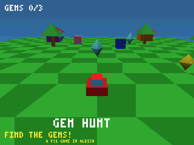

# AlbiPSX — a PS1 game engine in Albish, kindergarten easy

**Make little PlayStation-1-style games by typing friendly words.**
No maths homework. No big words. If you can type, you can make a game.



*The picture above was painted by the engine itself — run `./screenshot.sh` to paint it again.*

---

## ▶ Play the game that comes with it (30 seconds)

1. Open a terminal in this folder.
2. Type `./play.sh` and tap Enter.
3. You see the world. You are the red car.
4. Type some letters, then tap Enter:
   - `w` = go · `s` = back up · `a` = turn left · `d` = turn right
   - You can type lots at once, like `wwwdww` — the car does every letter.
   - `q` = stop playing.
5. **Find all 3 gems to win!**

No typing mood? `./autoplay.sh` — a robot plays by itself so you can watch.

## ★ Make YOUR game (2 minutes)

1. Open `my_first_game.alb` in any text editor.
2. Change the words in the lines. This is a whole game:

```albish
import easy

easy.start("MY GAME")
easy.make_ground("grass")
easy.make_sky("sky")
easy.add_tree(3, 2)
easy.add_house(5, 6, "blue")
easy.add_mountain(-7, -6, "gray")
easy.add_gem(0, -2)
easy.add_gem(-3, 3)
easy.put_player(0, -6, "red")
easy.shout("FIND THE GEMS!")
easy.play()
```

3. Save it, then type `./play_mine.sh`.

### The friendly words

| Word | What it does |
|---|---|
| `easy.start("NAME")` | Begin. Pick any name. |
| `easy.make_ground("grass")` | The floor. Also `"stone"`, `"sand"`, `"wood"`, `"party"`, or any colour. |
| `easy.make_sky("sky")` | The sky colour. |
| `easy.add_tree(right, away)` | A tree. |
| `easy.add_house(right, away, "red")` | A house with a roof. |
| `easy.add_mountain(right, away, "gray")` | A big mountain. |
| `easy.add_box(right, away, "blue")` | A block. |
| `easy.add_ball(right, away, "pink")` | A chunky ball. |
| `easy.add_gem(right, away)` | A gem to collect. Get them all to win! |
| `easy.put_player(right, away, "red")` | YOU — the hero you drive. |
| `easy.shout("WORDS!")` | Big words on the screen. |
| `easy.play()` | PLAY! Always the last line. |

**The two numbers** are always *(steps RIGHT, steps AWAY)*. Whole numbers only.
Minus numbers go the other way: `add_tree(-4, 3)` = 4 steps left, 3 steps away.
Keep numbers between -9 and 9.

**Colours you can say:** `red` `orange` `yellow` `green` `grass` `sky` `blue`
`purple` `pink` `brown` `white` `black` `gray` `gold` `teal` `lime`.
A colour it doesn't know becomes pink, so the game never breaks.

**Bumping:** trees, houses, mountains, blocks and balls are solid — bump into
one and the game says `BONK!` and you stay put. Gems are treasure: drive
through one to collect it, with sparkles.

---

## The rules it keeps (the under-250 MB promise)

The whole game — engine, picture, world and all — must use **less than
250 MB of RAM**. In real life it uses about **13 MB**. That is measured,
not promised: `python3 measure_ram.py ~/workspace/albish/bin/albish autoplay.alb`
prints the peak. The engine is built small on purpose:

| Part | Size |
|---|---|
| Screen picture (320×240, 2 bytes a pixel) | 150 KB |
| Depth buffer | **none** (the PS1 way) |
| Pictures (textures) | 6 tiny 32×32 pictures = 12 KB |
| Triangles in one picture | at most 600 |
| Sparkles at once | at most 64 |
| Things in the world | pooled lists, nothing grows forever |

## Why it looks like a PlayStation 1

- **Tiny screen:** 320×240, like PS1 games on an old TV.
- **Few colours:** 15-bit colour — 32 shades each of red, green, blue.
- **No decimal maths in 3D:** everything is fixed-point numbers (1.0 = 4096),
  like the PS1's GTE chip. Lookup-table sine/cosine, integer division.
- **Wobbly corners:** corner positions snap to a coarse grid before drawing,
  so edges shimmer when things move — the famous PS1 wobble.
- **Warpy pictures:** textures are stretched the affine way (straight-line
  across the screen, no perspective fixing), so floors bend like PS1 floors.
- **No Z-buffer:** the PS1 didn't have one. Triangles are sorted far-to-near
  and painted in that order (the painter's way).
- **Chunky light:** light levels snap to 16 steps, so shading comes in bands.
- **Honest limits:** a triangle that pokes behind the camera is skipped whole
  (that's why the ground is an 8×8 rug of small squares — the square under
  the camera is skipped, the rest still draw). Words on screen use a tiny
  3×5 letter set. Sound is not in the engine — Albish has no sound maker.

## Files

| File | What it is |
|---|---|
| `easy.alb` | **Start here.** The friendly words. |
| `engine.alb` | The grown-up engine under the hood (renderer, 3D, sparkles). |
| `game.alb` | GEM HUNT, the demo game (written with the friendly words). |
| `my_first_game.alb` | Your template. Copy it, change it. |
| `autoplay.alb` | A robot plays GEM HUNT by itself. |
| `screenshot.alb` | Paints one picture → `output/frame.ppm` + `frame.png`. |
| `bench.alb` | Spins a world for 12 pictures and reports the work. |
| `test_engine.alb` | 46 checks that the engine works. `./test.sh` |
| `verify.sh` | Runs **everything** and writes the verdict to `results.txt`. |
| `measure_ram.py` | Runs a game and prints its true peak RAM. |
| `ppm2png.py` | Turns the engine's PPM pictures into PNG (stdlib only). |
| `albipsx.albproj` | Albish project card. |

## Run the proof

```bash
./verify.sh        # all checks, robot playthrough, picture, RAM — writes results.txt
./test.sh          # just the 46 engine checks
./bench.sh         # 12 spinning pictures + the RAM budget
./screenshot.sh    # repaint output/frame.png
```

**One quirk to know:** Albish finds its parts (`import easy`, `import engine`)
in the folder you start from — that's why every `.sh` script steps into this
folder first. Always launch games through the scripts (or `cd` here first).

*Built entirely in Albish 2.0, running on the native Albish engine —
sovereign features included: `nesejo` hides collected gems from the
world, and `shfaq` reveals your new gem count each time you grab one.*
